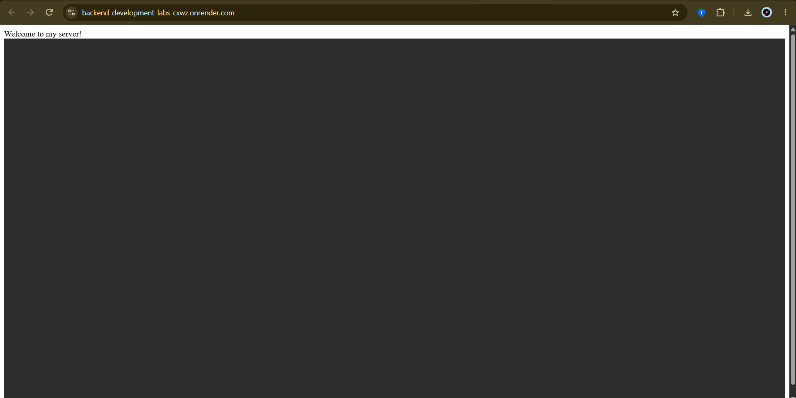
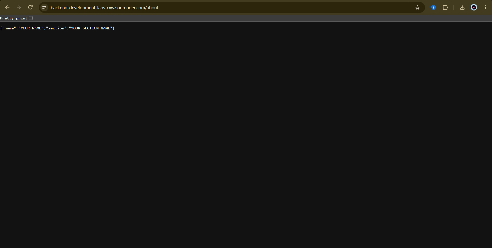
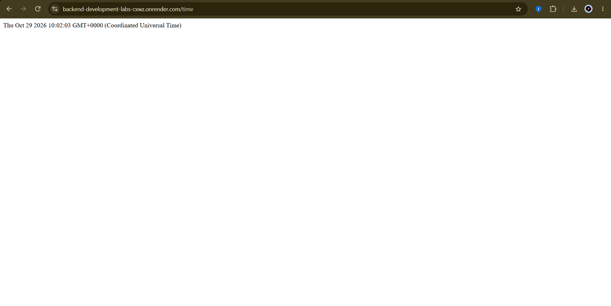
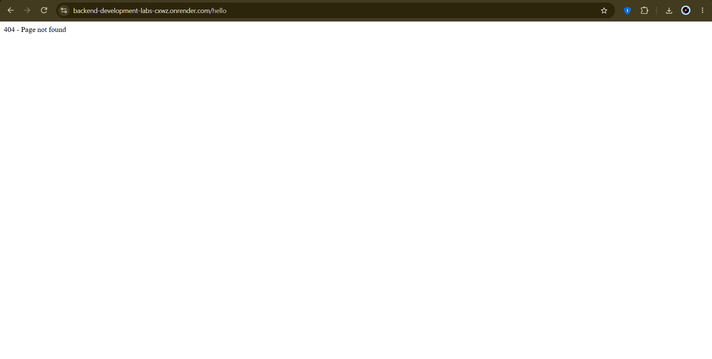

# Lab 1: Node.js and Express Server

## Student Details

* **Name:** NEELI SRI CHARAN
* **Registration Number:** 252U1R9109
* **Section:** CSE GEN-AI
* **Course:** Backend Development Fundamentals
* **Lab Number:** 01

---

## Live Demo

**Live URL:** https://backend-development-labs-cxwz.onrender.com/

> After deploying the server, replace this placeholder with your public URL. If deployment is not possible, provide Postman screenshots of all endpoints as required by the lab instructions.

---

## Aim

To set up a Node.js project and build a web server using the built-in HTTP module, then implement the same functionality using Express.js. The server provides multiple routes and returns appropriate responses and HTTP status codes.

## Technologies Used

* **Node.js** — JavaScript runtime environment.
* **Express.js** — Web framework for Node.js.
* **JavaScript** — Programming language.
* **npm** — Package manager for Node.js.

## Project Structure

```text
lab-01/
├── screenshots/
│   ├── home.png
│   ├── about.png
│   ├── time.png
│   └── not-found.png
├── node_modules/
├── .gitignore
├── package.json
├── package-lock.json
├── server.js
└── README.md
```

> `node_modules/` is generated automatically when dependencies are installed. Do not commit it to GitHub.

## Installation and Setup

### Prerequisites

Make sure you have the following installed:

* Node.js
* npm
* A web browser
* Git (optional, for GitHub submission)

### Step 1: Clone the Repository

```bash
git clone <https://github.com/nsricharan01-design/BACKEND-DEVELOPMENT-LABS.git>
```

Navigate to the lab directory:

```bash
cd <BACKEND-DEVELOPMENT-LABS>/lab-01
```

### Step 2: Install Dependencies

```bash
npm install
```

If Express.js has not yet been installed, run:

```bash
npm install express
```

### Step 3: Start the Server

```bash
node server.js
```

The server should start on port `3000`.

Open your browser and visit:

```text
http://localhost:3000
```

**Note:** This lab does not require environment variables when using the default port `3000`.

## API Endpoints

The Express server provides the following endpoints:

| HTTP Method | Endpoint         | Description                                             | Expected Status Code |
| ----------- | ---------------- | ------------------------------------------------------- | -------------------- |
| GET         | `/`              | Returns a welcome message.                              | 200 OK               |
| GET         | `/about`         | Returns JSON containing the student's name and section. | 200 OK               |
| GET         | `/time`          | Returns the current date and time.                      | 200 OK               |
| GET         | Any unknown path | Returns a 404 Not Found message.                        | 404 Not Found        |

### 1. Home Route

**Endpoint:** `GET /`

**URL:** `http://localhost:3000/`

**Description:** Displays a welcome message.

**Expected Response:**

```text
Welcome to my Node.js and Express server!
```

**Status Code:** `200 OK`

### 2. About Route

**Endpoint:** `GET /about`

**URL:** `http://localhost:3000/about`

**Description:** Returns the student's name and section in JSON format.

**Example Response:**

```json
{
  "name": "Your Name",
  "section": "Your Section"
}
```

**Status Code:** `200 OK`

### 3. Time Route

**Endpoint:** `GET /time`

**URL:** `http://localhost:3000/time`

**Description:** Returns the current date and time using JavaScript's `new Date()`.

**Example Response:**

```json
{
  "currentTime": "2026-10-27T10:00:00.000Z"
}
```

**Status Code:** `200 OK`

*Note: The timestamp above is an example. The actual response depends on when the endpoint is requested.*

### 4. Unknown Route

**Example Endpoint:** `GET /unknown`

**URL:** `http://localhost:3000/unknown`

**Description:** Returns an error message when the requested route does not exist.

**Example Response:**

```text
404 - Page Not Found
```

**Status Code:** `404 Not Found`

## Screenshots

Add screenshots of your actual working server responses to the `screenshots/` folder.

### Home Route



### About Route



### Time Route



### Unknown Route — 404 Error



> Replace these image placeholders with screenshots captured from your own running server. Make sure the screenshots clearly show the URL and response.

## Concepts Learned

* Initializing a Node.js project using `npm init -y`.
* Understanding the purpose of `package.json` and `node_modules`.
* Creating a basic HTTP server using Node.js's built-in `http` module.
* Installing and using Express.js.
* Creating routes using Express.
* Sending text and JSON responses.
* Generating the current date and time using `new Date()`.
* Handling unknown routes with a 404 status code.
* Testing endpoints and checking HTTP status codes.

## Viva Questions

### 1. What is the difference between `package.json` and `node_modules`?

`package.json` contains project metadata, scripts, and dependency declarations. `node_modules` contains the installed packages and their dependencies.

### 2. What does `app.listen()` do?

`app.listen()` starts the Express application listening for incoming HTTP requests on the specified port.

### 3. What do request and response represent?

* **Request (`req`):** Contains information about the incoming HTTP request.
* **Response (`res`):** Provides methods for sending data and status codes back to the client.

## Problems Faced and Solutions

Document any issues encountered while setting up or running the server and explain how you resolved them.

Examples you can adapt if they match your actual experience:

* **Port already in use:** Stopped the process using the port or selected another available port.
* **Express module not found:** Installed Express using `npm install express`.
* **Route not found:** Checked the route paths and added a 404 handler after the other routes.

## GitHub Submission

Before submitting, verify that:

* [ ] The project runs without errors.
* [ ] All endpoints return the expected responses.
* [ ] HTTP status codes are correct.
* [ ] Screenshots of the working routes are included.
* [ ] A `.gitignore` file is present.
* [ ] `node_modules/` and `.env` are not committed.
* [ ] The repository is public or shared with the faculty.
* [ ] The GitHub repository URL is submitted.
* [ ] The live deployment URL is included, or the reason for not deploying is documented with Postman screenshots.

---

**Lab 01 completed:** Node.js and Express server fundamentals.
